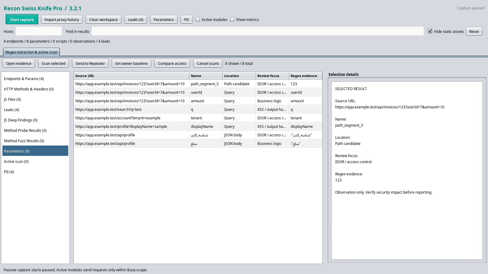
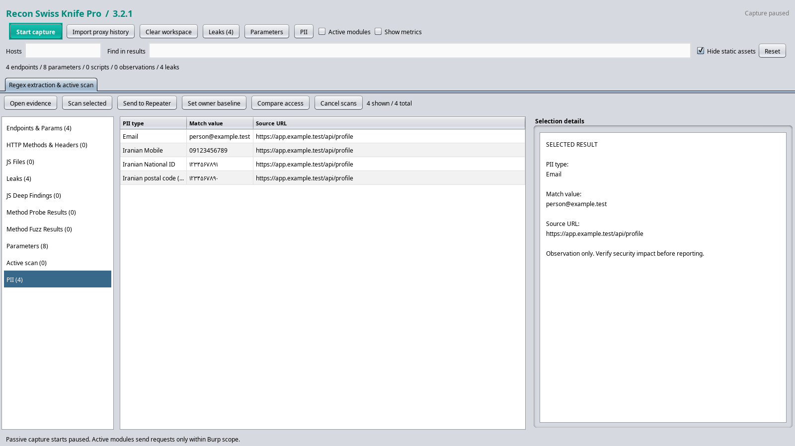

# Recon Swiss Knife Pro 3.2.1

A single-file **Python / Jython 2.7 Burp extension** for regex extraction and evidence-driven review of **IDOR/access control, XSS, business logic and PII**. No AI settings, model calls, API keys or provider dependencies.

## Install / update

1. Configure Jython standalone 2.7.4 in Burp's Python extension settings.
2. Remove or unload the older Recon Swiss Knife extension.
3. **Extensions → Installed → Add → Python**: select **`ReconSwissKnife_v3.py`**.
4. Confirm `Recon Swiss Knife Pro 3.2.1 loaded successfully.` in extension output.

Only the generated Python file is needed in Burp. The `recon/` package is for development.

## Why findings were hard to see in 3.1.0

The reported screenshot already contained seven leak matches and 167 observations. The result-category tabs were not all visible in Burp's theme, leaving the endpoint table on screen. This release uses an explicit scrollable category list and content cards instead of left-positioned Swing tabs. **Leaks** and **PII** also have direct buttons that clear the result search and open their category.

Live results now refresh after each analyzed message, with queued updates coalesced. Previously fewer than 15 messages could leave the display stale. Static assets are hidden from the endpoint view by default, while their captured data remains available; uncheck **Hide static assets** to show them.

Active modules showing zero results can mean the target is outside **Burp Target scope**. The status bar now explains scope skips. Setting the extension's **Hosts** filter alone does not authorize network requests.

## Capture and extract

- Set **Hosts** to your target hostnames, comma-separated, to avoid browser/third-party noise. Matching accepts exact hosts and subdomains. Empty accepts all passive traffic.
- **Start capture** analyzes new responses. **Import proxy history** explicitly analyzes existing traffic.
- Select a category on the left: endpoints, methods/headers, scripts, leaks, JS findings, method probes, method tests, parameters, active scan, or PII.
- **Find in results** is literal text search; **Reset** clears it. Counts show visible and total rows.
- Select a row to inspect details. **Open evidence** / double-click opens the native request/response viewer. **Send to Repeater** retains the original request.

### Parameters and review focus

Built-in bounded regexes extract query names, URL-encoded form fields, nested JSON keys, multipart names, HTML input/select/textarea names, and JavaScript get/set/append literals. Numeric/UUID path segments are listed as access-control candidates. Response JSON keys are also candidates.

The **Parameters** table records source URL, name, location, review focus and regex evidence. Request inputs are distinguished from response-derived candidates; a response key is not proof that the server accepts it as input.

Review-focus hints highlight:

| Focus | Examples | Next action |
| --- | --- | --- |
| IDOR / access control | `userId`, `account_id`, `tenant`, numeric/UUID path segments | Compare the same resource across two supplied identities |
| XSS / output handling | `q`, `search`, `comment`, `html`, `content` | Scan selected GET query inputs, then inspect the response context |
| Business logic | `role`, `price`, `quantity`, `discount`, `status`, `step` | Define the expected rule and verify the workflow in Repeater |
| PII | Email, phone, national ID, IBAN, possible card numbers | Inspect source evidence and whether that identity should receive the data |

These are prioritization hints, not vulnerability classifications.

## IDOR and access-control workflow

1. Capture an authenticated **owner's GET request** for a protected resource. Select it and click **Set owner baseline**. The same action is available from Burp's own request context menu.
2. Obtain a request for the **exact same URL** from another user or an anonymous session. Supply this request yourself; the tool does not acquire or invent credentials.
3. Select that request and click **Compare access**, or use **Recon: compare access with owner baseline** from Burp's request context menu. Using Burp's menu is useful when both sessions have the same endpoint URL.
4. Describe the expected access rule, such as “user B must not read user A's invoice.” This confirms sending **two fresh GET requests**.
5. Read **Active scan** results: owner status, second-session status, body equality and your stated expectation. Use native evidence/Repeater to verify protected fields and actual permissions.

The owner baseline must have authentication, the second request must use different or absent authentication, both must be GET, and the URL must match exactly. Public pages, login/error pages returning HTTP 200, and intentionally shared objects must be excluded manually. Two successful statuses or identical bodies alone do not prove IDOR.

## Selected active scan / XSS review

1. Add the target to **Burp Target → Scope**.
2. Select a captured GET request and click **Scan selected**.
3. Confirm a bounded scan: **at most 12 requests** — one fresh baseline, up to two probes for each of five distinct observed query parameters, and one CORS origin check.
4. Inspect **Active scan** outcomes:
   - **XSS reflection:** a unique inert marker with delimiters tests whether input is reflected unescaped, transformed/escaped, or outside HTML. It does not send an executable script or establish browser execution.
   - **Error differential:** a quote probe checks for new known SQL/stack-trace signatures absent from the fresh baseline.
   - **CORS origin:** a reserved `.invalid` origin checks for arbitrary-origin reflection with credentials. Sensitive authenticated read access still needs verification.

Original authentication is retained. Active requests ask for `Accept-Encoding: identity`, do not automatically follow redirects, and recheck scope before each send. Requests share a minimum 0.3-second spacing and a bounded queue. Extension-generated traffic is not re-enqueued for automatic probing, which prevents request amplification. POST and other state-changing methods are not automatically replayed by this selected scanner. Legacy risky-method tests remain a separate, explicitly confirmed context-menu action.

**Cancel scans** stops further requests/results from selected scan and comparison jobs after an in-flight request returns. Clearing the workspace also invalidates those jobs. Optional automatic JS fetching / OPTIONS-HEAD probing has its own checkboxes and is not disabled by hiding the **Active modules** section.

## Business logic

The tool highlights rule-sensitive parameters and supports two-session comparisons with an explicit expected outcome. Multi-step issues such as coupon reuse, negative quantities, approval bypasses or payment-state transitions require application-specific state and manual Repeater verification. This version does not automatically manipulate purchases, balances, permissions or workflow transitions.

## PII and leak extraction

The **PII** category separates emails, Iranian/international phone formats, Iranian national IDs, Iranian IBANs and possible payment-card numbers. National IDs, IBANs and card patterns use checksum validation. **Leaks** additionally contains regex matches for credentials, bearer/JWT-like tokens and cloud endpoints.

Matches are observations: public contact details, sample data and an authenticated user's own PII may be legitimate. Findings retain their source message for review; nothing is sent to an external analysis provider.

Gzip and zlib-wrapped deflate response bodies are decoded with an 800 KB output cap. Unsupported encodings, including Brotli, create a visible “body scan skipped” observation. Configure your test traffic to provide uncompressed responses when needed. JavaScript already captured in traffic is deep-scanned without requiring an additional fetch.

### Persian / Iranian web apps (3.2.1)

The locale rules handle Persian and Arabic-Indic digits, formatted Iranian mobile and landline numbers, checksum-validated national IDs/Sheba, known-prefix bank cards, and context-labeled postal codes. They also recognize supported JSON/HTML-escaped Persian values while retaining the original match text. Persian parameter names receive IDOR/XSS/logic/PII review hints.

See the [Iranian pattern reference](docs/iranian-patterns.md) for examples, validators and limitations.

## Development / verification

See [CONTRIBUTING.md](CONTRIBUTING.md) for the repository layout, tests and cache cleanup. Edit the modules and regenerate the installation file:

```sh
python3 tools/bundle.py
python3 tools/bundle.py --check
```

`recon/core/` contains pure regex extraction, focus hints, differential rules and validators. `recon/burp/extension.py` contains Burp integration, bounded task execution, storage and Swing UI. Never edit the generated file as a second implementation.

```sh
python3 -m unittest discover -s tests -p test_core.py
python3 -m unittest discover -s tests -p test_bundle.py
python3 tools/verify.py --jython /path/to/jython-standalone-2.7.4.jar --burp-api /path/to/burp-extender-api-2.3.jar
```

The full workflow tests modular and bundled entry points, deterministic generation, standalone installation, real Swing widgets, compression/PII extraction and a disposable loopback target for active and cross-session checks. No external target or real credentials are needed. See [refactoring roadmap](docs/refactoring.md). Live Burp theme and browser execution checks remain manual acceptance steps.

## Synthetic UI preview




Previews use synthetic data and Nimbus look and feel; Burp supplies its own theme.
