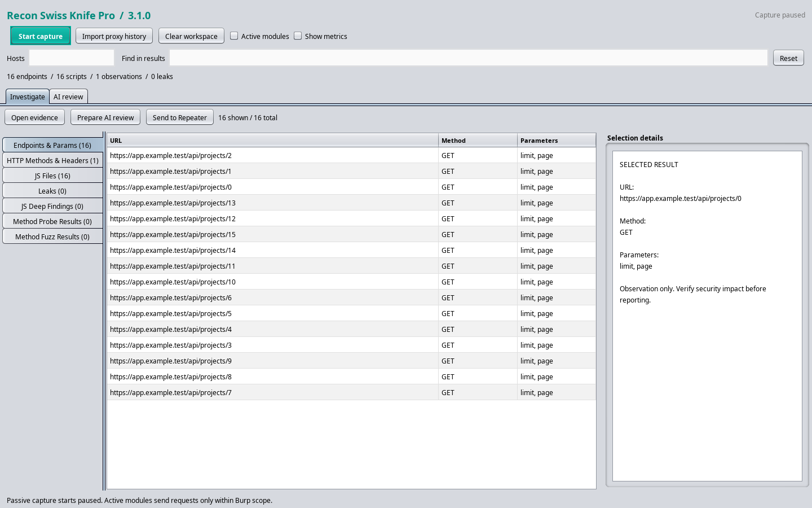
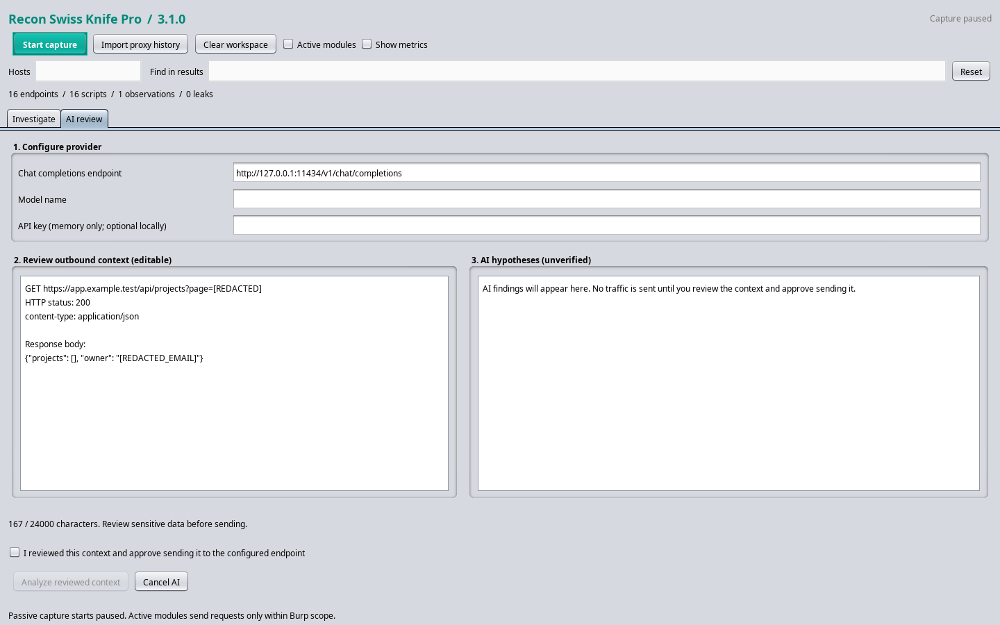

<p align="center">
  
  
  
  
</p>

# 🔪 Recon Swiss Knife Pro 3.1.0

### Semi-Active Security Recon & Method Fuzzer for Burp Suite

> A production-grade Burp Suite extension for passive reconnaissance, semi-active probing, and active cross-method fuzzing — all in one sleek, dark-mode dashboard.

---

## ✨ Key Features

### 🔍 Passive Reconnaissance Engine
- **Endpoint & Parameter Extraction** — Automatically collects all URLs, query parameters, POST body parameters, and JSON keys from proxied traffic.
- **JavaScript File Discovery** — Detects `.js` files from URL paths and HTML `<script src="">` tags.
- **HTTP Method Detection** — Flags risky HTTP methods (`PUT`, `DELETE`, `TRACE`, `PATCH`, `OPTIONS`, `DEBUG`, `CONNECT`).
- **Security Header Auditing** — Checks CSP/framing policies for HTML, HSTS for HTTPS, and `X-Content-Type-Options`. Missing obsolete `X-XSS-Protection` is no longer flagged.
- **Cookie Security Analysis** — Parses attributes to detect missing `Secure` on HTTPS, `HttpOnly`, and explicit `SameSite`. Cookie values cannot spoof attribute presence.

### 🇮🇷 Iranian Target Focus
- **National ID Validation** — Detects 10-digit Iranian National ID numbers with full checksum verification.
- **Mobile Number Detection** — Identifies Iranian mobile numbers in `+98`, `0098`, and `09xx` formats.

### 🔐 Advanced Secret Detection Engine
| Secret Type | Regex Pattern |
|---|---|
| OpenAI / Anthropic API Keys | `sk-[A-Za-z0-9]{32,}` |
| Google Cloud / YouTube API Keys | `AIzaSy[A-Za-z0-9_\-]{33}` |
| GitHub Personal Access Tokens | `ghp_[A-Za-z0-9]{36}` |
| Firebase Database URLs | `https?://[a-z0-9\-]+\.firebaseio\.com` |
| AWS Access Keys | `(AKIA\|ASIA)[0-9A-Z]{16}` |
| AWS Secret Keys | Context-aware pattern matching |
| JWT Tokens | `ey[...].{...}.{...}` three-part structure |
| Bearer Tokens | `bearer [token]` header values |
| Generic API Keys / Secrets | `api_key`, `access_token`, `secret_key` patterns |
| Email Addresses | Standard RFC-like email patterns |

### 🌐 Semi-Active Modules
- **Auto JS Deep-Fetch** — Proactively downloads in-scope JavaScript files and scans them for hidden API endpoints, S3 buckets, cloud storage URLs, fetch/AJAX targets, and relative API paths.
- **Auto Method Probe (OPTIONS/HEAD)** — Sends lightweight `OPTIONS` requests (with `HEAD` fallback) to discovered endpoints to enumerate allowed HTTP methods via `Allow` headers.

### ⚡ Active Cross-Method Fuzzer
- **Right-Click Fuzzing** — Select any endpoint row, right-click → *"Test Risky Methods (Fuzz Endpoint)"*.
- **Method Coverage** — Sends `PUT`, `DELETE`, `PATCH`, `DEBUG`, and `TRACE` requests.
- **Evidence Labels** — Successful status codes are labeled **"Method accepted - impact unverified"**. A successful status alone does not prove a bypass.
- **Full Logging** — All fuzz results (including blocked attempts) are logged with the complete HTTP request/response for review.

### 🖥️ Professional UI/UX
- **Dark-Mode / Light-Mode Auto-Detection** — Adapts to Burp's current theme automatically.
- **Compact Summary** — Always-visible result totals, with eight optional metrics revealed by **Show metrics**.
- **Tab Count Badges** — Each tab title shows a live count of its findings (e.g., `"Leaks (42)"`).
- **Investigation Workspace** — Compact controls, left-side categories, a resizable selection inspector, and metrics hidden until requested.
- **Interactive Search & Scope Filtering** — Filter all tables in real-time with literal text search.

### 🔎 Native Pop-up Viewer (Double-Click)
- **Full Request/Response** — Opens a resizable, non-modal `JDialog` with Burp's native `IMessageEditor`, showing **Raw**, **Headers**, and **Hex** tabs.
- **Leak Auto-Highlighting** — When double-clicking a leak row, the popup includes an `ITextEditor` panel with the leaked secret value automatically highlighted and scrolled to.
- **JS Beautifier** — When inspecting a `.js` file, the response body is automatically beautified with proper indentation before display.

---

## 📦 Installation

### Prerequisites
- **Burp Suite** Professional or Community Edition (2020.x or later recommended)
- **Jython Standalone JAR** (2.7.x) — [Download from jython.org](https://www.jython.org/download)

### Step 1: Configure Jython in Burp Suite

1. Open Burp Suite.
2. Navigate to **Extensions → Extension Settings** (or **Extender → Options** in older versions).
3. Under **Python Environment**, click **Select file...** and browse to your downloaded `jython-standalone-2.7.x.jar`.
4. Burp will confirm the Jython environment is configured.

### Step 2: Load the Extension

1. Go to **Extensions → Installed** (or **Extender → Extensions**).
2. Click **Add**.
3. Set **Extension type** to **Python**.
4. Click **Select file...** and browse to `ReconSwissKnife_v3.py`.
5. Click **Next** — the extension will load and a new tab **"Recon Swiss Knife"** will appear.

### Step 3: Verify

Check the **Output** tab in the extension details — you should see:
```
Recon Swiss Knife Pro 3.1.0 loaded successfully.
```

---

## 🚀 Usage

### Basic Workflow

1. **Set Scope** — Enter comma-separated hostnames in the **Hosts** (e.g., `example.com, api.target`). Matching includes exact hosts and subdomains. An empty filter accepts all passive traffic. **Active fetching, probes and fuzzing additionally require Burp Target scope membership.**

2. **Enable Passive Recon** — Click **Start capture** to monitor new traffic, and **Pause capture** to stop. This will:
   - Begin monitoring live traffic in real-time.
   - Use **Import proxy history** to import existing traffic explicitly (also works while capture is paused).

3. **Browse Your Target** — Navigate the target application normally. The extension passively extracts findings.

4. **Review Findings** — Check each tab for results:
   - **Endpoints & Params** — Discovered URLs with methods and parameters.
   - **HTTP Methods & Headers** — Risky methods and missing security headers.
   - **JS Files** — Discovered JavaScript files.
   - **Leaks** — Exposed secrets, tokens, PII.
   - **JS Deep Findings** — Hidden endpoints found inside JS files.
   - **Method Probe Results** — Allowed methods per endpoint.
   - **Method Fuzz Results** — Active fuzzing results.

### Inspecting Findings (Double-Click)

Double-click any row in any table to open the **Request/Response Popup**:
- View the full HTTP request and response with Burp's native message editor.
- For **Leak** rows: the leaked value is automatically highlighted in the response body.
- For **JS** rows: the response body is automatically beautified with proper indentation.

### Active Fuzzing (Right-Click)

1. Right-click any row in any table.
2. Select **"Test Risky Methods (Fuzz Endpoint)"**.
3. The extension will send `PUT`, `DELETE`, `PATCH`, `DEBUG`, and `TRACE` requests to the endpoint.
4. Results appear in the **"Method Fuzz Results"** tab.
5. A confirmation dialog precedes fuzzing because these methods can modify data. Results marked **"Method accepted - impact unverified"** require baseline comparison and impact verification. Existing request authentication is retained; PUT/PATCH retain the original body.

### Semi-Active Modules

- **Auto Deep-Fetch JS** *(checkbox)* — When enabled, the extension automatically downloads newly-discovered `.js` files and scans them for hidden endpoints and cloud resources.
- **Auto Method Probe** *(checkbox)* — When enabled, sends `OPTIONS`/`HEAD` requests to new endpoints to discover allowed HTTP methods.

### Additional Features

- **Import proxy history** — Re-analyze all existing proxy traffic.
- **Clear Data** — Reset all findings and counters.
- **Find in results** — Literal text search across all result tables.
- **Right-Click → Copy** — Copy URLs, parameters, or match values to clipboard.
- **Right-Click → "Send to Recon Swiss Knife"** — Available in Burp's own tools (Proxy, Repeater, etc.) to manually feed items into the extension.

---


## AI review (new in 3.0.0)

The extension remains a **single Python source file for Jython 2.7**. The Java rewrite has been removed. Existing recon tables, native message popups, JS fetching, method fuzzing, and Iranian-specific detection remain available.

1. Right-click any collected row with a request/response and choose **Prepare AI review (redacted preview)**.
2. The **AI review** workspace opens with an editable context preview and a result panel. Set a full OpenAI-compatible chat-completions URL, a model name, and an optional API key.
3. Local example: `http://127.0.0.1:11434/v1/chat/completions` with a model installed in your local server. Hosted example: `https://api.openai.com/v1/chat/completions` with a model available to your account and its API key. No particular model is bundled.
4. Review the exact outbound text, approve sending, then click **Analyze reviewed context**. Editing the endpoint, model, key or context resets approval.
5. Results remain **unverified hypotheses** with exact evidence quotes and suggested verification steps. No AI-generated request is executed. Use the new **Send original request to Repeater** action for manual verification.

The context excludes request headers and bodies. Query values and common response secrets, emails, Iranian phone numbers and ten-digit identifiers are redacted; only selected response headers and at most 12,000 body characters are included. **Redaction is best effort:** inspect URL paths and arbitrary body values before sharing, or use a local model. Keys remain in process memory and are never saved to project files or Burp settings.

Remote providers require HTTPS; local loopback HTTP is supported. TLS verification remains enabled and redirects are disabled. One review runs at a time, with a 24,000-character context limit, 1,800 requested output tokens, 1 MB response limit, 10-second connection and 45-second read timeouts. Cancel/clear invalidates late results; transport cancellation may take until its timeout. There are no automatic provider retries or automatic per-message AI charges. Traffic is marked as untrusted data in the model prompt; responses must satisfy a schema and quote text from the reviewed context. These controls validate structure and quotes, not security conclusions.

Active tasks use six workers, a queue of 64 jobs, and at least 0.3 seconds between request starts. Scope is checked again before request construction. Queue failures are reported in extension errors, and rejected JS/probe jobs can be retried. Captured request context is retained for same-URL probes/fuzzing. Relative JS links are resolved against their parent page before use.

### Refactored development sources

`ReconSwissKnife_v3.py` is the **generated installation artifact**. Continue loading that one file in Burp; copying the `recon/` package is unnecessary.

Edit `recon/` for development:

- `recon/core/`: pure redaction, provider URL validation, cookie parsing, evidence labels and national-ID validation.
- `recon/ai/`: pure AI prompt, schema/evidence validation, and context formatting.
- `recon/burp/extension.py`: the remaining Burp/Swing/network implementation and thin message-extraction adapter.

Rebuild after editing sources; do not edit the generated file directly:

```sh
python3 tools/bundle.py
python3 tools/bundle.py --check
```

The bundler uses an explicit dependency order, removes only supported internal imports, retains standard-library/Java imports, and produces identical bytes for identical inputs. Unsupported dependency ordering, aliases, star imports, and relative internal imports fail the build. No timestamps or machine-specific paths enter the artifact.

### Developer checks

Python 3 runs pure-core and build-tool checks without Burp:

```sh
python3 -m unittest discover -s tests -p test_core.py
python3 -m unittest discover -s tests -p test_bundle.py
```

For full verification, supply Jython standalone 2.7.4 and Burp Extender API 2.3 (test classpath only):

```sh
python3 tools/verify.py --jython /path/to/jython-standalone-2.7.4.jar --burp-api /path/to/burp-extender-api-2.3.jar
```

This checks deterministic bundling, 36 pre-refactoring baseline cases, pure modules under both Python 3 and Jython, and the complete extension suite against **both** modular sources and the generated artifact. It also copies only the generated file into an isolated directory, confirms the development package is unavailable, and constructs the Swing UI there. Mock-provider tests require permission to bind a loopback port; no real provider credentials or target application are used.

To render synthetic UI previews:

```sh
java -Djava.awt.headless=true -cp /path/to/jython.jar:/path/to/burp-api.jar org.python.util.jython -B tests/render_ui.py
```

Set `RECON_TEST_TARGET=source` to render/test the modular entry point. On Windows use `;` as the Java classpath separator. Live Burp and real-model acceptance remain separate manual checks.

## UI / UX update in 3.1.0

- **Investigate** contains categories on the left, result tables in the center, and a resizable **Selection details** pane.
- Select a row to enable **Open evidence**, **Prepare AI review**, and **Send to Repeater**. Existing double-click and context-menu actions remain available.
- **Hosts** filters passive collection by hostname; **Find in results** performs literal text search. **Reset** clears the result search. Visible/total row counts explain filtered results.
- **Active modules** reveals the optional JS fetch/probe controls; hiding this section does not disable modules already enabled. Both modules start off on load.
- **Show metrics** reveals the detailed counters. Capture starts paused, and importing history is a separate action.
- Refreshes preserve unchanged selected rows and coalesce repeated UI update requests. Repeated method/header observations are deduplicated by URL and issue.
- **AI review** labels the provider, editable context and hypothesis steps. A character counter and send-button validation show when the reviewed context is ready.
- Literal Unicode escape text in the old header and popup labels is replaced by readable separators.

[Refactoring roadmap](REFACTOR_PLAN.md) describes the next stages; this release keeps the single-file installation.

Synthetic Swing previews (Nimbus look and feel; Burp uses its own theme):




## 📸 Screenshots

> The previews above use synthetic data. The layout follows Burp's active look and feel at runtime.

| View | Description |
|---|---|
| Dashboard | Main interface with metric cards and tabbed data tables |
| Leak Popup | Double-click popup with auto-highlighted secret value |
| JS Viewer | Beautified JavaScript response in popup |
| Fuzz Results | Method fuzz results showing bypass detections |

---

## 🏗️ Architecture

```
┌─────────────────────────────────────────────┐
│              BurpExtender (Main)             │
│  IHttpListener + ITab + IContextMenuFactory  │
│  + IExtensionStateListener                   │
├─────────────────┬───────────────────────────┤
│  ReconAnalyzer  │     ActiveEngine          │
│  (Passive)      │  (Semi-Active / Active)   │
│  - Endpoints    │  - JS Deep-Fetch          │
│  - Parameters   │  - Method Probe           │
│  - JS Files     │  - Cross-Method Fuzz      │
│  - Leaks/PII    │  - ExecutorService Pool   │
│  - Headers      │                           │
├─────────────────┴───────────────────────────┤
│              DataStore (Thread-Safe)         │
│  All findings retain IHttpRequestResponse   │
├─────────────────────────────────────────────┤
│              ReconUI (Swing EDT)             │
│  - Dashboard + Metric Cards                 │
│  - 7 Tabbed Data Tables                     │
│  - RequestResponsePopup (JDialog)           │
│  - Leak Highlighting (ITextEditor)          │
│  - JS Beautifier (Pure Python)              │
└─────────────────────────────────────────────┘
```

---

## ⚠️ Disclaimer

> **This tool is intended for authorized security testing and educational purposes only.**
>
> Use this extension **only** against systems you have explicit written permission to test. Unauthorized access to computer systems is illegal in most jurisdictions. The authors assume **no liability** for misuse of this tool.
>
> By using this software, you agree to comply with all applicable local, state, national, and international laws and regulations.
>
> **The semi-active and active modules (JS Deep-Fetch, Method Probe, Cross-Method Fuzz) send real HTTP requests to target servers.** Ensure you have proper authorization before enabling these features.

---

## 📄 License

This project is provided under the [MIT License](LICENSE).

---

## 🤝 Contributing

Contributions, issues, and feature requests are welcome. Please open an issue or submit a pull request.

---

<p align="center">
  <b>Made with ☕ for the security community</b>
  <br>
  <sub>Recon Swiss Knife Pro v3 — Because every endpoint deserves a second look.</sub>
</p>
